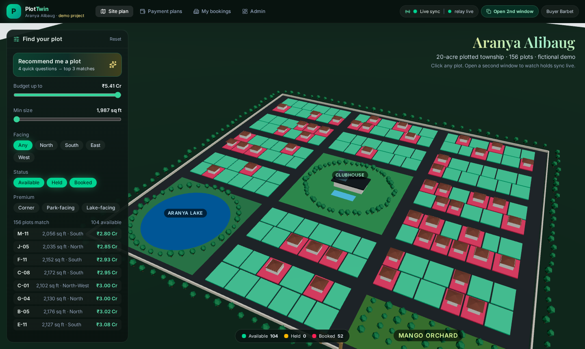
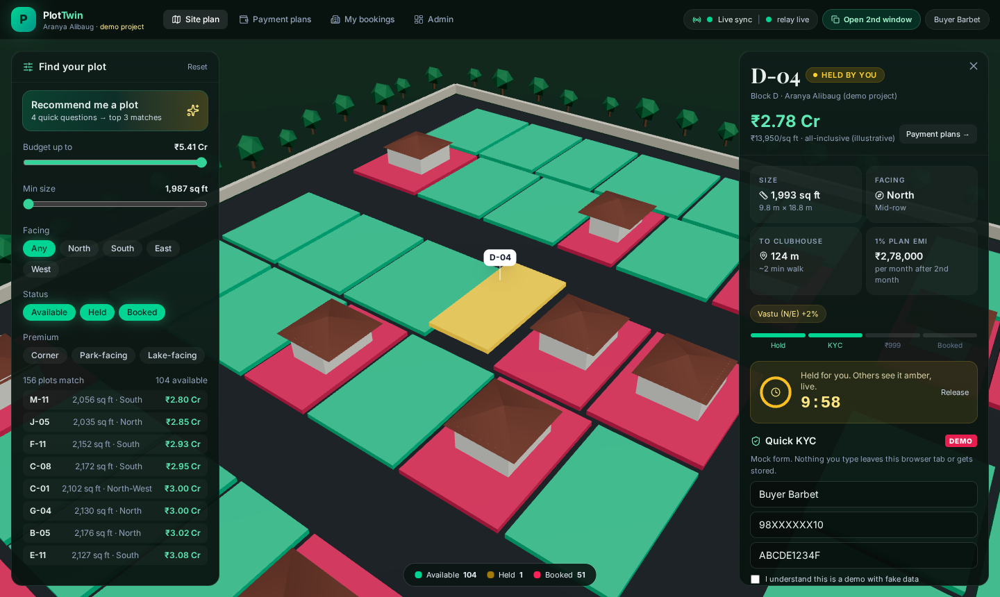
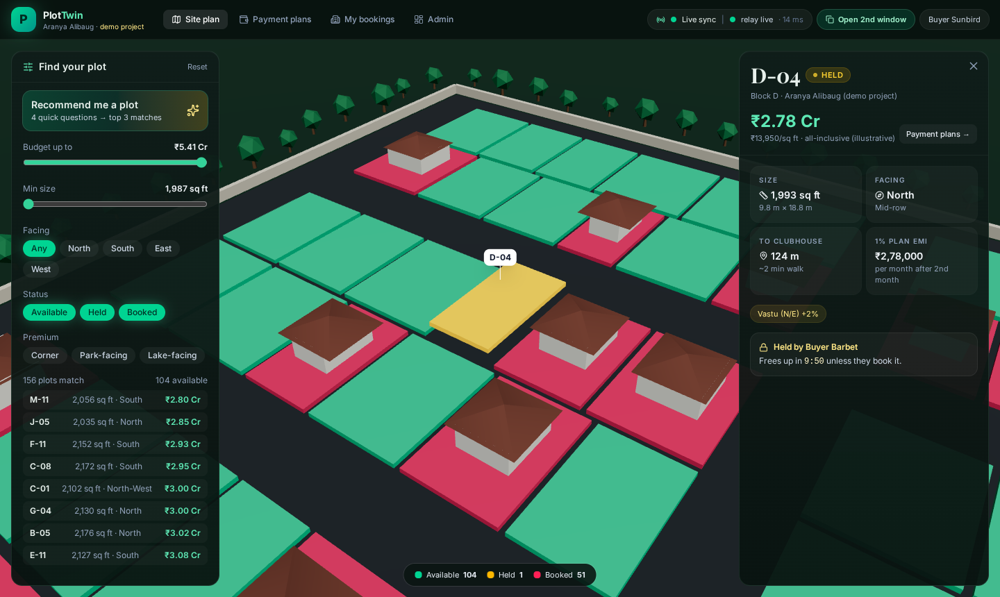
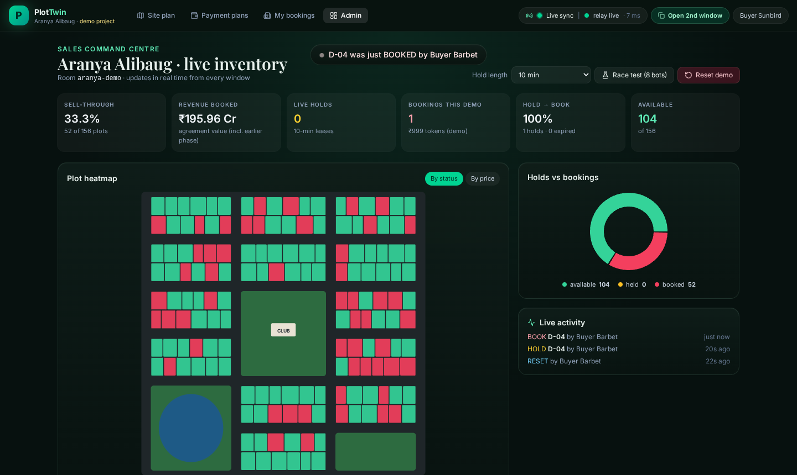
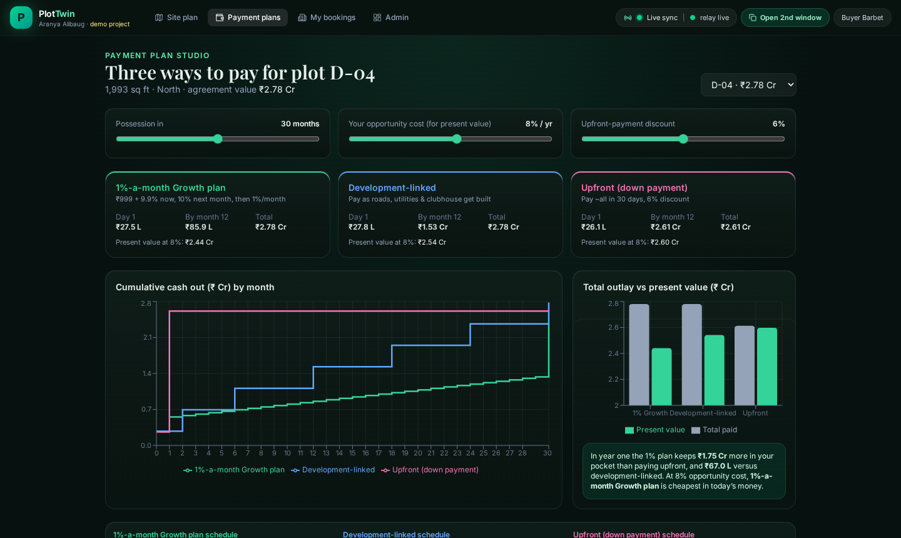
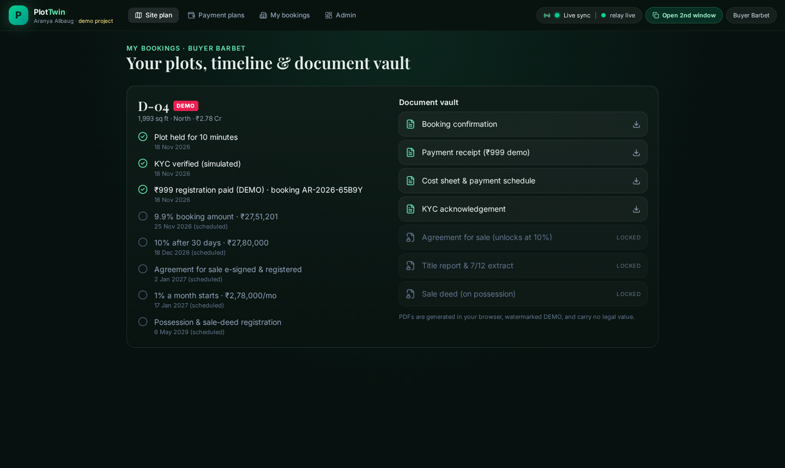

# PlotTwin: a real-time 3D digital twin for plotted developments

**Live demo:** https://jiyasingh18.github.io/plottwin/ (mirror: https://plottwin-wheat.vercel.app)

> **Aranya Alibaug is a fictional demo project.** Plots, prices, KYC and the ₹999 payment are all mock. No real payment is taken and no personal data is stored.

PlotTwin is a prototype of the "buy land without visiting" experience. Buyers explore a 3D site plan, find a plot, hold it for 10 minutes, pass a mock KYC and a ₹999 demo registration, and get a booking timeline and document vault. **Every hold and booking appears in every other open window within about a second**, and conflicts are resolved first-writer-wins.



| Hold with live countdown | Second window sees it instantly |
|---|---|
|  |  |

| Admin command centre | Payment plan studio |
|---|---|
|  |  |



## Features
- **3D site plan** (react-three-fiber + drei): 156 procedurally generated plots across 13 blocks, plus roads, a clubhouse and pool, a lake, an orchard, a gate and instanced trees. Plots are colour-coded by live status, booked plots grow a villa, and held plots pulse. There's a hover card, click to fly the camera to a plot, orbit and zoom, and a ripple whenever a plot changes.
- **Discovery:** filters for budget, size, facing, status, corner, park-facing and lake-facing, with non-matches dimmed in 3D. The **"Recommend me a plot"** quiz ranks live availability.
- **Booking flow:** a 10-minute hold lease with a countdown ring, mock KYC, a mock ₹999 UPI payment (clearly marked DEMO), then BOOKED. It ends with a timeline and a vault of 4 PDFs generated in the browser (jsPDF), all watermarked DEMO.
- **Payment studio:** compares the 1%-a-month Growth plan (₹999 + 9.9% + 10% + 1%/month), a development-linked plan and an upfront plan with a discount. It shows a cumulative cash-flow chart, total paid vs present value, and full schedules.
- **Admin:** sell-through, revenue booked, live holds, hold-to-book conversion, a status donut, sell-through by block, a heatmap (by status or price), a live activity feed, an **8-bot race test**, a hold-length switch (10 min / 2 min / 30 s) and **Reset demo**.

## Real-time sync design
```
UI ──► PlotStore ──► merge(current, incoming)   // pure, deterministic
          │  same browser: localStorage + Web Lock (atomic read-check-write)
          │                + BroadcastChannel fan-out (few ms)
          └─ cross-device: pluggable Transport → ntfy.sh relay (HTTPS/SSE, no key, 12h replay)
```
- One versioned record per plot (`ver`, `epoch`, `at`, `exp`). A higher epoch wins, then a higher version. If two writers raced from the same version, the **earliest claim wins**, and on a tie the lower client id wins.
- Holds are **leases**: expiry is evaluated on read, so they free themselves even if the holder disappears.
- Rules: you can't hold a held or booked plot, each buyer gets one live hold at a time, and you can only book a plot you hold while the hold is live.
- `?room=name` gives a private room, and `?relay=off` keeps sync same-browser only.

**Honest note:** in the same browser this is strict first-writer-wins. Across devices it goes through a free public best-effort relay and the tie-break trusts client clocks. Production needs an authoritative service (a Postgres conditional `UPDATE` or Redis `SET NX PX` plus a WebSocket fan-out). See [EXPLAINER.md](EXPLAINER.md).

## Run locally
```bash
npm install
npm run dev        # http://localhost:5173/plottwin/
npm run build      # type-check + production build
npm run deploy:pages   # publish dist/ to the gh-pages branch
```
Open the app in two windows side by side, hold a plot in one, and watch the other.

## Stack
Vite 8 · React 19 · TypeScript · Tailwind CSS 4 · three.js / @react-three/fiber / drei · framer-motion · recharts · jsPDF · lucide icons. Fully static, with no secrets and no backend to run.

## Tested
Playwright with headless Chromium (SwiftShader WebGL) against the live site: two pages in one context, hold in A and see it held in B, B is blocked from holding, book in A and B sees booked, the 8-bot race gives 1 winner, a 30-second hold expires automatically, desktop (1440) and laptop (1280) layouts are checked, and there are zero console errors.

## Deploy
GitHub Pages is served from the `gh-pages` branch (`scripts/deploy-pages.sh`). An equivalent Actions workflow is in `deploy/github-pages-workflow.yml`: move it to `.github/workflows/` with a token that has `workflow` scope. Vercel auto-deploys `main` (the base path switches to `/` on Vercel).

---
Built by **Jiya Singh** (B.Tech CS, AI & ML). Fictional data, for portfolio use only.
